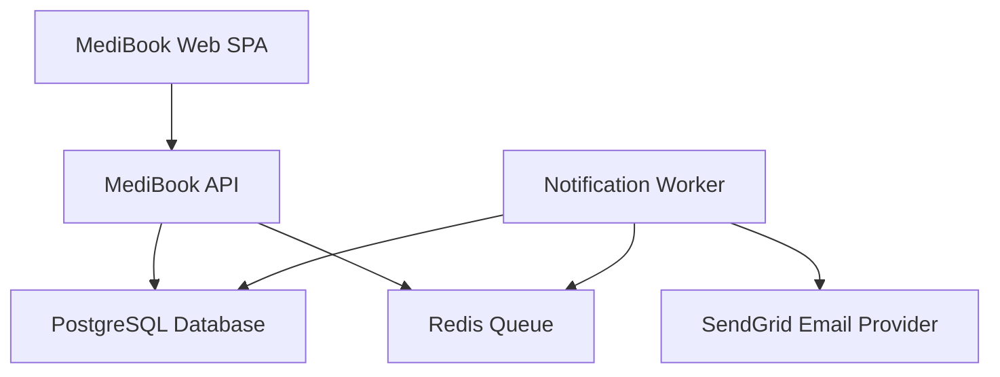
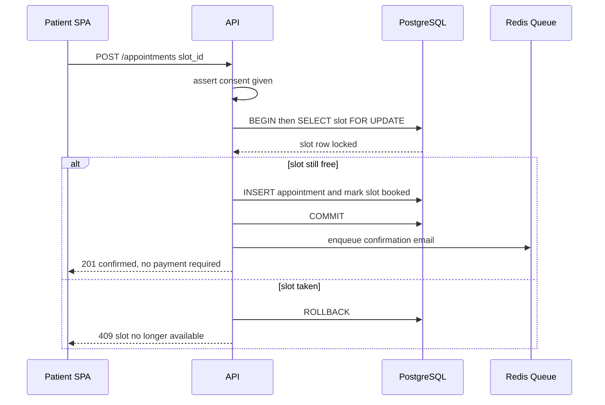
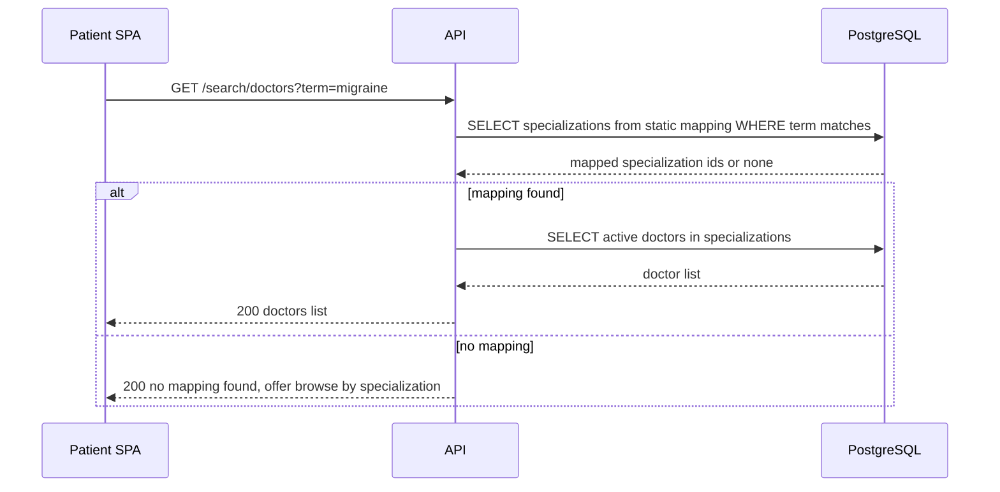
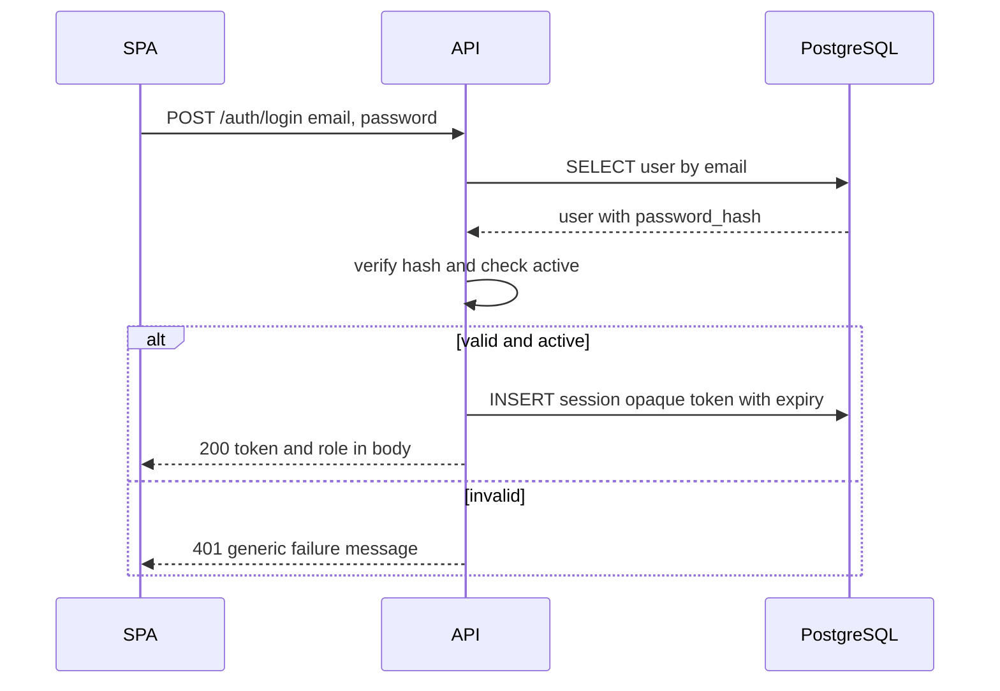
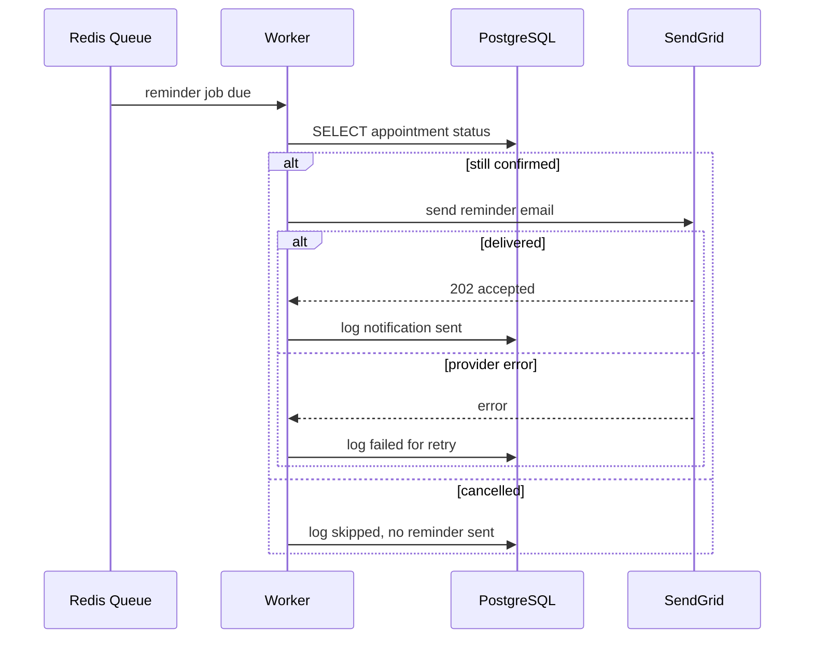
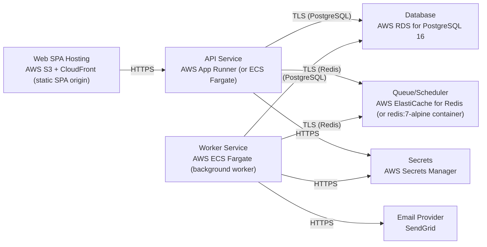

# Architecture

> Maintained by QuorQ AI SDLC. Text between `sdlc:auto` markers is regenerated; anything outside them is yours and is kept.

<!-- sdlc:auto:start narrative -->
## Overview

### ARCH-OVERVIEW · approved · source: architecture:summary

Approved v1 architecture for MediBook: a responsive web app for a single-clinic pilot covering patient self-registration, disease/specialization doctor search, real-time slot booking/reschedule/cancel, doctor availability and consultation records, and admin oversight.

MediBook is built as a React 19 SPA calling a FastAPI 0.115 API backed by PostgreSQL 16, deployed on AWS. Booking integrity uses PostgreSQL row-level locking; a Redis-backed Celery worker sends confirmation/reschedule/cancellation emails and scheduled reminders via SendGrid without blocking bookings. Sessions are server-side opaque tokens for role-based access (patient/doctor/admin). Explicitly out of scope: AI/ML, telehealth, native mobile app, and online payment. Health data protections noted as general best practice: encryption in transit and at rest, consent capture, and audit logging.

### ARCH-WEB · approved · source: architecture:component:web

MediBook Web SPA built in React 19, serving patients, doctors and admins from one responsive codebase.

Single-page app covering registration/sign-in, doctor search, slot calendars, booking/reschedule/cancel flows, patient/doctor/admin dashboards, consultation record entry, and admin management screens. Reads the API base URL from the VITE_API_BASE_URL environment variable and sends Authorization: Bearer <token> on every API call. Runs in any mobile browser, satisfying the no-native-app decision.

### ARCH-API · approved · source: architecture:component:api

FastAPI 0.115 service holding all business logic and authorization for MediBook.

Owns authentication and opaque-token session management, role-based authorization, the static disease-to-specialization mapping lookup, availability/slot generation, transactional booking with double-booking prevention, consultation records, admin management functions, audit logging, and enqueuing of notification jobs onto the Redis queue.

### ARCH-WORKER · approved · source: architecture:component:worker

Celery-based Notification Worker that sends appointment emails and reminders asynchronously.

Consumes the Redis queue and runs scheduled jobs: sends booking confirmation, reschedule and cancellation emails; schedules and dispatches upcoming-appointment reminders; logs failed sends for retry/review so booking operations are never blocked by email delivery.

### ARCH-DB · approved · source: architecture:component:db

PostgreSQL 16 is the system of record for all MediBook data.

Stores users, profiles, consent, specializations, disease mappings, availability, slots, appointments, consultation records, sessions, notification log and audit entries. Enforces booking integrity via row-level locking and transactions (SELECT ... FOR UPDATE on the slot row) and is encrypted at rest.

### ARCH-QUEUE · approved · source: architecture:component:queue

Redis 7 acts as the message broker and scheduling backend for the notification worker.

Enables asynchronous, non-blocking dispatch of confirmation, reschedule, cancellation and reminder emails by decoupling the API's booking transaction from SendGrid delivery.

### ARCH-EMAIL · approved · source: architecture:component:email

SendGrid provides transactional email delivery for all patient-facing appointment notifications.

Delivers booking confirmation, reschedule, cancellation and reminder messages to patients' registered email addresses; the worker logs failures for retry/review rather than surfacing them to the booking flow.

### ARCH-CP-BOOKING · approved · source: architecture:critical-path:booking

Describes how MediBook prevents double-booking when a patient books a free future slot.

A consented patient books a free future slot. The API opens a transaction, locks the slot row (SELECT ... FOR UPDATE), verifies it is still free, creates the appointment, marks the slot booked, then enqueues a confirmation email. Concurrent submissions for the same slot serialize on the lock so only one succeeds; the losing request is told the slot is no longer available. No payment is requested as part of this flow.

### ARCH-CP-SEARCH · approved · source: architecture:critical-path:search

Describes the non-AI, mapping-based doctor search by disease or symptom.

A patient enters a disease or symptom term. The API looks it up in the predefined disease_mappings table using a case-insensitive exact/alias match, resolves one or more specializations, and returns active doctors in those specializations. If no mapping exists, the patient is told and offered browse-by-specialization instead. Explicitly no AI/ML is used in this lookup.

### ARCH-CP-LOGIN · approved · source: architecture:critical-path:login

Describes the opaque-token session sign-in flow used for role-based access.

A user signs in with email and password. The API verifies the password hash, checks the account is active, creates a session row with an opaque token and an inactivity expiry, and returns the token in the response body. The SPA stores it and sends it as a Bearer token on subsequent calls. Sign-out, inactivity expiry, and account deactivation all revoke the session server-side.

### ARCH-CP-REMINDER · approved · source: architecture:critical-path:reminder

Describes the scheduled appointment reminder email flow.

On booking confirmation, the worker schedules a reminder for a configured lead time. When due, the worker checks the appointment is still confirmed (not cancelled) and sends the reminder via SendGrid. If SendGrid fails, the attempt is logged for retry and the underlying booking is unaffected.

### ARCH-DATA-MODEL · approved · source: architecture:entities

Relational data model underpinning MediBook, covering identity, scheduling, clinical records and auditing.

Entities: users (id, email, phone, password_hash, role, full_name, is_active, created_at); sessions (token, user_id, created_at, last_activity_at, expires_at, revoked_at); patient_consents (id, patient_id, consented, consented_at); specializations (id, name, is_active); doctor_profiles (id, user_id, specialization_id, bio, contact); disease_mappings (id, term); disease_mapping_specializations (mapping_id, specialization_id); doctor_availability (id, doctor_id, day_of_week, start_time, end_time, slot_length_minutes); appointment_slots (id, doctor_id, start_at, end_at, status); appointments (id, slot_id, patient_id, doctor_id, status, created_at); consultation_records (id, appointment_id, patient_id, doctor_id, notes, diagnosis, prescription, updated_at); notification_log (id, appointment_id, kind, status, error, created_at); audit_logs (id, user_id, action, entity_type, entity_id, created_at).

### ARCH-EP-AUTH · approved · source: architecture:endpoints:auth

Authentication and account-provisioning endpoints.

POST /auth/register: patient self-registration with email, phone, password; rejects duplicate email or invalid fields; stores password hashed. POST /auth/login: sign in, returns opaque session token in body on success, generic failure message otherwise. POST /auth/logout: revokes the current session token server-side. POST /admin/users: admin provisions a doctor or admin account with password placeholder <set-at-first-login> recorded (not a real credential).

### ARCH-EP-PROFILE · approved · source: architecture:endpoints:profile

Profile and consent management endpoints.

GET /me/profile: view own patient or doctor profile. PUT /me/profile: update own profile; email uniqueness enforced; doctor specialization limited to the admin-defined list. POST /me/consent: patient gives health-data consent, stored with a timestamp.

### ARCH-EP-SEARCH-AVAILABILITY · approved · source: architecture:endpoints:search-availability

Doctor search and availability/slot management endpoints.

GET /search/doctors: search doctors by disease/symptom (static mapping) or specialization, returning active doctors or a no-mapping message. GET /doctors/{doctor_id}/slots: real-time list of unbooked future slots for a doctor. PUT /me/availability: doctor sets recurring weekly hours and slot length; overlaps are merged/rejected, with a warning if an existing booking is affected. PUT /admin/doctors/{doctor_id}/availability: admin overrides a doctor's availability or blocks time ranges, warning about affected booked appointments.

### ARCH-EP-BOOKING · approved · source: architecture:endpoints:booking

Appointment booking, reschedule, cancellation and dashboard endpoints.

POST /appointments: book a whole slot with server-side double-booking prevention (slot locked FOR UPDATE); requires consent; no payment. PUT /appointments/{id}/reschedule: move an upcoming appointment to another free slot under the same locking rules; original slot released. POST /appointments/{id}/cancel: cancel an upcoming appointment, freeing its slot; completed/past appointments cannot be cancelled. GET /me/appointments: patient dashboard of upcoming and past appointments with doctor, specialization, date/time and status. GET /doctor/appointments: doctor dashboard of scheduled appointments with patient name, date/time, slot and status, with an empty-state when none.

### ARCH-EP-CONSULTATION · approved · source: architecture:endpoints:consultation

Consultation record and status-update endpoints, access-controlled and audit-logged.

PUT /appointments/{id}/consultation: treating doctor saves free-text notes, diagnosis and optional prescription; access denied for non-treating doctors; audit-logged. GET /appointments/{id}/consultation: view consultation record, visible only to the owning patient, treating doctor and admins; audit-logged. PUT /appointments/{id}/status: treating doctor updates status (scheduled/completed/no_show); invalid transitions, e.g. completing a cancelled appointment, are rejected.

### ARCH-EP-ADMIN · approved · source: architecture:endpoints:admin

Administrative oversight, configuration and audit endpoints.

GET /admin/appointments: oversight of all appointments with filters by doctor, patient, date and status. PUT /admin/appointments/{id}/reassign: reassign an appointment to another doctor/slot under the same locking rules, with parties notified. GET/POST/PUT/DELETE /admin/specializations: manage specializations; deletion warns/blocks on dependencies (doctors or mappings). GET/POST/PUT/DELETE /admin/mappings: maintain the disease/symptom-to-specialization mapping; rejects mapping to a non-existent specialization. PUT /admin/doctors/{doctor_id}/status: deactivate/reactivate a doctor; deactivation removes them from search, ends sessions, flags appointments. GET /admin/audit-logs: review access/change events for consultation records and appointments. PUT /admin/email-settings: configure the transactional email provider API key, stored as a secret and never displayed.

### ARCH-DEPLOY-WEB · approved · source: architecture:deployment:web-spa-hosting

Static hosting for the React 19 SPA.

Deployed as a React 19 static build served from AWS S3 with CloudFront as the static SPA origin.

### ARCH-DEPLOY-API · approved · source: architecture:deployment:api-service

Hosting for the FastAPI backend service.

FastAPI 0.115 on Python/Uvicorn, served over HTTPS, deployed on AWS App Runner (or ECS Fargate as an alternative).

### ARCH-DEPLOY-WORKER · approved · source: architecture:deployment:worker-service

Hosting for the background notification worker.

Celery worker plus beat scheduler on Python, deployed on AWS ECS Fargate as a dedicated background worker service.

### ARCH-DEPLOY-DB · approved · source: architecture:deployment:database

Managed database hosting for PostgreSQL 16.

AWS RDS for PostgreSQL 16, with encryption at rest via KMS and automated backups.

### ARCH-DEPLOY-QUEUE · approved · source: architecture:deployment:queue-scheduler

Managed Redis hosting for the queue/scheduler.

AWS ElastiCache for Redis 7 (or a redis:7-alpine container as an alternative) backing the worker's queue and scheduling.

### ARCH-DEPLOY-EMAIL · approved · source: architecture:deployment:email-provider

SendGrid as the external SaaS email provider.

SendGrid's transactional email API is used for all outbound appointment-related emails; it is an external SaaS dependency, not hosted within the AWS account.

### ARCH-DEPLOY-SECRETS · approved · source: architecture:deployment:secrets

Centralized secrets storage for sensitive configuration.

AWS Secrets Manager stores SENDGRID_API_KEY, REDIS_URL and DATABASE_URL as managed secrets; the admin email-settings endpoint stores the provider API key as a secret and never displays it.

### ARCH-TECH-FRONTEND · approved · source: architecture:tech-decision:frontend

React 19 chosen as the frontend framework over Vue and Angular.

Builds the single responsive SPA serving patients on phones, doctors managing their day, and the admin dashboard, including live slot calendars and record entry. Runs in any mobile browser, meeting the project's no-native-app decision.

### ARCH-TECH-BACKEND · approved · source: architecture:tech-decision:backend

FastAPI 0.115 chosen as the backend framework over Django REST Framework and Flask.

Hosts all booking integrity, role-based authorization and the static mapping lookup in clean, typed endpoints, pairing with PostgreSQL row locking to implement the double-booking guard.

### ARCH-TECH-DATABASE · approved · source: architecture:tech-decision:database

PostgreSQL 16 chosen as the database over MySQL and SQL Server.

Transactions and row-level locking (SELECT FOR UPDATE on the slot row) directly implement 'book a slot exactly once'; holds the relational doctor/specialization/mapping/appointment data and supports encryption at rest for health-data safeguards.

### ARCH-TECH-CLOUD · approved · source: architecture:tech-decision:cloud

AWS chosen as the cloud provider over GCP and Azure.

One account provides managed PostgreSQL (RDS with KMS encryption and backups), app/worker hosting, Redis (ElastiCache), and Secrets Manager for the SendGrid key, with audit-friendly access controls, and scales beyond the pilot without re-platforming.
<!-- sdlc:auto:end narrative -->

<!-- sdlc:auto:start building-blocks -->
## Building Block View

| ID | Name | Technology | Responsibility | Depends on |
|---|---|---|---|---|
| web | MediBook Web SPA | React 19 | Responsive single-page app for patients, doctors and admins: registration/sign-in, doctor search, slot calendars, booking/reschedule/cancel, dashboards, consultation record entry, and admin management screens. Reads API base URL from VITE_API_BASE_URL and sends Authorization: Bearer <token> on every call. | api |
| api | MediBook API | FastAPI 0.115 | FastAPI service holding all business logic: authentication and opaque-token sessions, role-based authorization, static disease-to-specialization mapping lookup, availability/slot generation, transactional booking with double-booking prevention, consultation records, admin management, audit logging, and enqueuing notification jobs. | db, queue |
| worker | Notification Worker | Celery on Python (Redis broker) | Background worker consuming the Redis queue and running scheduled jobs: sends booking confirmation, reschedule and cancellation emails, schedules upcoming-appointment reminders, and logs failed sends for retry/review without blocking bookings. | queue, db, email |
| db | PostgreSQL Database | PostgreSQL 16 | System of record for users, profiles, consent, specializations, disease mappings, availability, slots, appointments, consultation records, sessions, notification log and audit entries. Enforces booking integrity via row-level locking and transactions; encrypted at rest. | — |
| queue | Redis Queue | Redis 7 | Message broker and scheduling backend for the background worker so notification and reminder emails are dispatched asynchronously. | — |
| email | SendGrid Email Provider | SendGrid (SaaS) | Transactional email delivery for booking confirmation, reschedule, cancellation and reminder messages to patients' registered addresses. | — |

<!-- sdlc:auto:end building-blocks -->

<!-- sdlc:auto:start runtime -->
## Runtime View

### Book appointment with double-booking prevention

A consented patient books a free future slot. The API opens a transaction, locks the slot row (SELECT ... FOR UPDATE), verifies it is still free, creates the appointment and marks the slot booked, then enqueues a confirmation email. Concurrent submissions for the same slot serialize on the lock so only one succeeds; the loser is told the slot is no longer available. No payment is requested.

- **Components:** web, api, db, queue
- **Modules:** booking_service, slot_repository, consent_guard, notification_enqueue
- **Key functions:** book_slot(patient_id, slot_id), lock_slot_for_update(slot_id), assert_consent_given(patient_id), enqueue_email(kind, appointment_id)

### Search doctors by disease or symptom via static mapping

A patient enters a disease or symptom term. The API looks it up in the predefined mapping table (case-insensitive exact/alias match), resolves one or more specializations, and returns active doctors in those specializations. If no mapping exists the patient is told and offered browse-by-specialization. No AI/ML is used.

- **Components:** web, api, db
- **Modules:** mapping_lookup_service, doctor_search_service
- **Key functions:** resolve_specializations(term), list_active_doctors(specialization_ids)

### Sign in with opaque-token session

A user signs in with email and password. The API verifies the hash, checks the account is active, creates a session row with an opaque token and inactivity expiry, and returns the token in the response body. The SPA stores it and sends it as a Bearer token. Sign-out, inactivity expiry and deactivation revoke the session server-side.

- **Components:** web, api, db
- **Modules:** auth_service, session_repository, password_hasher
- **Key functions:** authenticate(email, password), create_session(user_id), revoke_session(token), validate_bearer(token)

### Scheduled reminder email

On booking confirmation the worker schedules a reminder for the configured lead time. When due, the worker checks the appointment is still confirmed (not cancelled) and sends the reminder via SendGrid; if SendGrid fails the attempt is logged for retry and the booking is unaffected.

- **Components:** worker, queue, db, email
- **Modules:** reminder_scheduler, email_sender, notification_log_repository
- **Key functions:** schedule_reminder(appointment_id, lead_time), send_reminder(appointment_id), log_notification(status, error)

<!-- sdlc:auto:end runtime -->

<!-- sdlc:auto:start deployment-view -->
## Deployment View

| Name | Service | Runtime | Scaling | Environment |
|---|---|---|---|---|
| Web SPA Hosting | AWS S3 + CloudFront (static SPA origin) | React 19 static build | CDN-served static assets | dev |
| API Service | AWS App Runner (or ECS Fargate) | FastAPI 0.115 on Python / Uvicorn, HTTPS | 1 small instance for pilot, horizontal if needed | dev |
| Worker Service | AWS ECS Fargate (background worker) | Celery worker + beat on Python | 1 worker for pilot | dev |
| Database | AWS RDS for PostgreSQL 16 | PostgreSQL 16, encryption at rest (KMS), automated backups | single instance, pilot-sized | dev |
| Queue/Scheduler | AWS ElastiCache for Redis (or redis:7-alpine container) | Redis 7 | single node | dev |
| Email Provider | SendGrid | SaaS transactional email API | managed by provider | dev |
| Secrets | AWS Secrets Manager | stores SENDGRID_API_KEY, REDIS_URL, DATABASE_URL | managed | dev |

| Source | Target | Protocol |
|---|---|---|
| Web SPA Hosting | API Service | HTTPS |
| API Service | Database | TLS (PostgreSQL) |
| API Service | Queue/Scheduler | TLS (Redis) |
| Worker Service | Queue/Scheduler | TLS (Redis) |
| Worker Service | Database | TLS (PostgreSQL) |
| Worker Service | Email Provider | HTTPS |
| API Service | Secrets | HTTPS |
| Worker Service | Secrets | HTTPS |

<!-- sdlc:auto:end deployment-view -->

<!-- sdlc:auto:start decisions -->
## Architecture Decisions

| Layer | Choice | ADR |
|---|---|---|
| Frontend | React 19 | [ADR-0001](adr/frontend.md) |
| Backend | FastAPI 0.115 | [ADR-0002](adr/backend.md) |
| Database | PostgreSQL 16 | [ADR-0003](adr/database.md) |
| Cloud | AWS | [ADR-0004](adr/cloud.md) |
<!-- sdlc:auto:end decisions -->

<!-- sdlc:auto:start links -->
## Related Documents

- [Data Model](data-model.md)
- [API Specification](api/openapi.yaml)
- [Architecture Decision Records](adr/README.md)
<!-- sdlc:auto:end links -->
