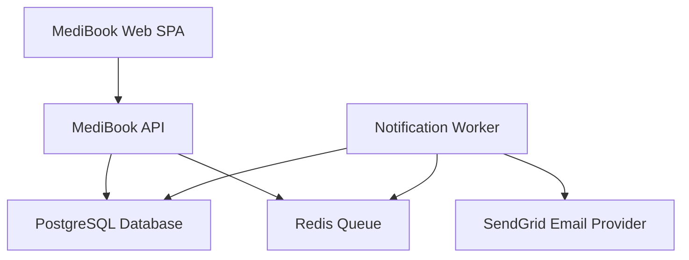
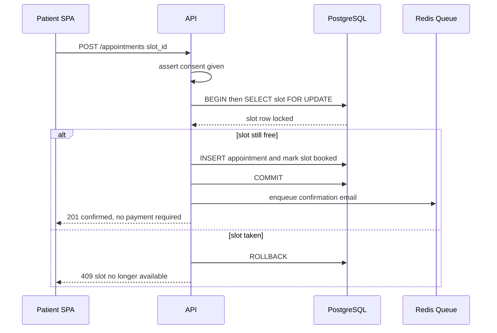
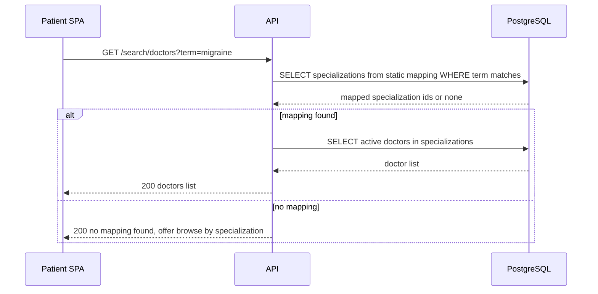
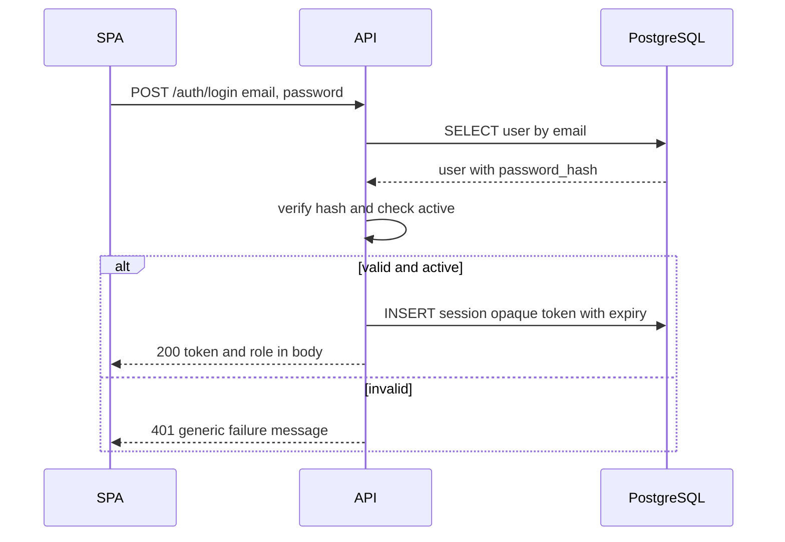
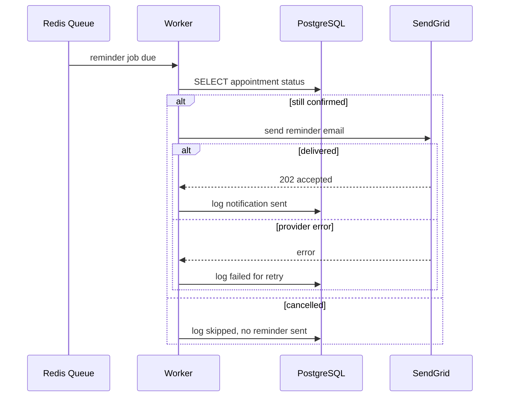
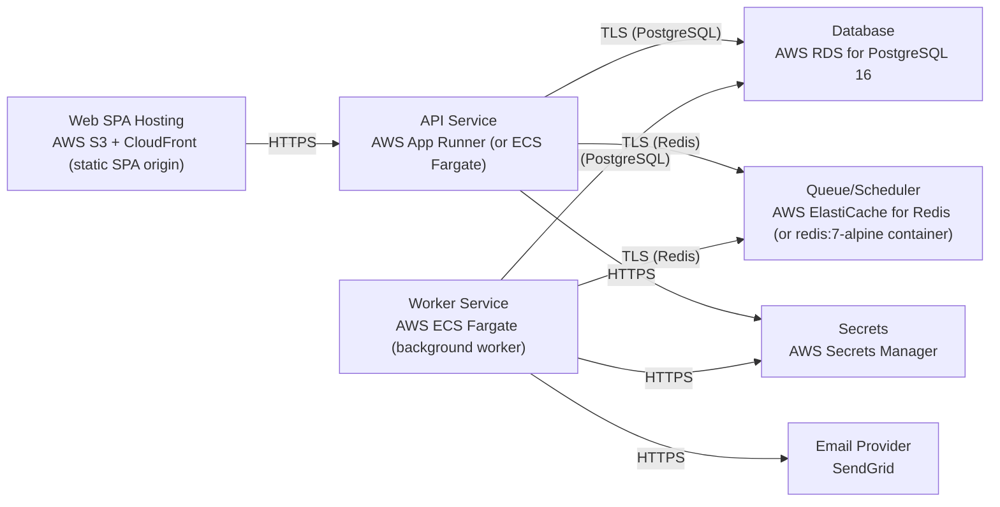

# Architecture

> Maintained by QuorQ AI SDLC. Text between `sdlc:auto` markers is regenerated; anything outside them is yours and is kept.

<!-- sdlc:auto:start narrative -->
## Overview

### ARCH-001 · approved · source: architecture:summary

Overall approved architecture for MediBook: a single-clinic pilot web app for patient self-registration, disease/symptom or specialization doctor search, real-time slot booking/reschedule/cancel with double-booking prevention, doctor availability and consultation record management, and admin oversight.

Version 1, status approved. Built on React 19 SPA + FastAPI 0.115 API + PostgreSQL 16 on AWS. Booking integrity enforced via PostgreSQL row-level locking (SELECT ... FOR UPDATE). Notifications (confirmation, reschedule, cancellation, scheduled reminders) are dispatched asynchronously by a Redis-backed Celery worker through SendGrid so bookings never block on email delivery. Access control uses server-side opaque-token sessions with role-based authorization for patients, doctors and admins. Explicitly out of scope: AI/ML (disease-to-specialization matching is a static predefined mapping table, not inference), telehealth, native mobile apps, and online payment. Health data is protected with encryption in transit and at rest, explicit patient consent capture, and audit logging as general best practice (not asserted as certified regulatory compliance).

### ARCH-COMP-WEB · approved · source: architecture:component:web

MediBook Web SPA: the single responsive React 19 front end serving patients, doctors and admins.

Single-page application covering registration/sign-in, doctor search, live slot calendars, booking/reschedule/cancel flows, patient and doctor dashboards, consultation record entry, and all admin management screens. Responsive design runs in any mobile browser, satisfying the no-native-app decision. Reads its API base URL from the VITE_API_BASE_URL environment variable and authenticates every API call by sending Authorization: Bearer <token>, where <token> is the opaque session token issued at login.

**Related:** ARCH-001

### ARCH-COMP-API · approved · source: architecture:component:api

MediBook API: the FastAPI 0.115 service holding all business logic, authorization, booking integrity, and the static disease-to-specialization lookup.

Responsibilities: authentication and opaque-token session issuance/revocation; role-based authorization; static disease/symptom-to-specialization mapping lookup; availability and slot generation; transactional booking with double-booking prevention; consultation record access control; admin management of users, specializations, mappings and appointments; audit logging; and enqueuing notification jobs onto the Redis queue for the worker. Exposed endpoints, grouped by area: Auth - POST /auth/register (patient self-registration, rejects duplicate email/invalid fields, password stored hashed), POST /auth/login (returns opaque session token in body on success, generic failure message otherwise), POST /auth/logout (revokes current session server-side); Admin provisioning - POST /admin/users (admin creates doctor/admin accounts; password field recorded only as placeholder <set-at-first-login>, never a real credential); Profile - GET /me/profile, PUT /me/profile (email uniqueness enforced; doctor specialization limited to admin-defined list), POST /me/consent (patient health-data consent stored with timestamp); Search & slots - GET /search/doctors (disease/symptom static-mapping or specialization search; returns active doctors or a no-mapping message), GET /doctors/{doctor_id}/slots (real-time unbooked future slots); Availability - PUT /me/availability (doctor sets recurring weekly hours and slot length; overlaps merged/rejected; warns if an existing booking affected), PUT /admin/doctors/{doctor_id}/availability (admin override/block with warning on affected bookings); Appointments - POST /appointments (books a whole slot with server-side locking, requires consent, no payment), PUT /appointments/{id}/reschedule (moves to another free slot under same locking, releases original slot), POST /appointments/{id}/cancel (frees slot; past/completed appointments cannot be cancelled), GET /me/appointments (patient dashboard), GET /doctor/appointments (doctor dashboard with empty-state); Consultation & status - PUT /appointments/{id}/consultation (treating doctor saves notes/diagnosis/prescription, access denied to non-treating doctors, audit-logged), GET /appointments/{id}/consultation (visible only to owning patient, treating doctor, admins; audit-logged), PUT /appointments/{id}/status (scheduled/completed/no_show, invalid transitions rejected); Admin oversight - GET /admin/appointments (filters by doctor/patient/date/status), PUT /admin/appointments/{id}/reassign (reassign doctor/slot under same locking, parties notified), GET/POST/PUT/DELETE /admin/specializations (deletion warns/blocks on dependencies), GET/POST/PUT/DELETE /admin/mappings (rejects mapping to non-existent specialization), PUT /admin/doctors/{doctor_id}/status (deactivate/reactivate removes from search, ends sessions, flags appointments), GET /admin/audit-logs (review access/change events), PUT /admin/email-settings (configures email provider API key, stored as secret, never displayed).

**Related:** ARCH-001, ARCH-COMP-DB, ARCH-COMP-QUEUE

### ARCH-COMP-WORKER · approved · source: architecture:component:worker

Notification Worker: a Celery-on-Python background worker (Redis broker) that sends all transactional and reminder emails without blocking bookings.

Consumes jobs from the Redis queue and runs scheduled jobs: booking confirmation, reschedule and cancellation emails; schedules and sends upcoming-appointment reminders at a configured lead time; logs failed sends for retry/review. Runs independently of the booking transaction so email delivery issues never affect booking success.

**Related:** ARCH-001, ARCH-COMP-QUEUE, ARCH-COMP-EMAIL

### ARCH-COMP-DB · approved · source: architecture:component:db

PostgreSQL 16 database: system of record for all MediBook data, enforcing booking integrity via row-level locking and transactions, encrypted at rest.

Entities: users (id, email, phone, password_hash, role, full_name, is_active, created_at); sessions (token, user_id, created_at, last_activity_at, expires_at, revoked_at); patient_consents (id, patient_id, consented, consented_at); specializations (id, name, is_active); doctor_profiles (id, user_id, specialization_id, bio, contact); disease_mappings (id, term); disease_mapping_specializations (mapping_id, specialization_id); doctor_availability (id, doctor_id, day_of_week, start_time, end_time, slot_length_minutes); appointment_slots (id, doctor_id, start_at, end_at, status); appointments (id, slot_id, patient_id, doctor_id, status, created_at); consultation_records (id, appointment_id, patient_id, doctor_id, notes, diagnosis, prescription, updated_at); notification_log (id, appointment_id, kind, status, error, created_at); audit_logs (id, user_id, action, entity_type, entity_id, created_at).

**Related:** ARCH-001, ARCH-COMP-API

### ARCH-COMP-QUEUE · approved · source: architecture:component:queue

Redis 7 queue: message broker and scheduling backend decoupling notification/reminder dispatch from the booking request path.

Used by the API to enqueue notification jobs and by the worker to consume them and schedule reminder sends, ensuring booking, reschedule and cancellation calls return without waiting on email delivery.

**Related:** ARCH-001, ARCH-COMP-WORKER

### ARCH-COMP-EMAIL · approved · source: architecture:component:email

SendGrid: external SaaS provider for transactional email delivery.

Delivers booking confirmation, reschedule, cancellation and reminder emails to patients' registered addresses on behalf of the Notification Worker. The provider API key is configured by an admin via PUT /admin/email-settings and stored as a secret, never displayed.

**Related:** ARCH-001, ARCH-COMP-WORKER

### ARCH-CP-BOOKING · approved · source: architecture:critical-path:booking

Book appointment with double-booking prevention: the core transactional flow guaranteeing a slot is booked exactly once.

A consented patient books a free future slot. The API opens a transaction, locks the slot row (SELECT ... FOR UPDATE), verifies it is still free, creates the appointment and marks the slot booked, then enqueues a confirmation email. Concurrent submissions for the same slot serialize on the lock so only one succeeds; the losing request is told the slot is no longer available. No payment is requested.

**Related:** ARCH-COMP-API, ARCH-COMP-DB, ARCH-COMP-WORKER

### ARCH-CP-SEARCH · approved · source: architecture:critical-path:search

Search doctors by disease or symptom via static mapping: non-AI lookup that resolves a patient's term to specializations and active doctors.

A patient enters a disease or symptom term. The API looks it up in the predefined mapping table (case-insensitive exact/alias match), resolves one or more specializations, and returns active doctors in those specializations. If no mapping exists the patient is told and offered browse-by-specialization instead. Explicitly implemented without AI/ML.

**Related:** ARCH-COMP-API, ARCH-COMP-DB

### ARCH-CP-LOGIN · approved · source: architecture:critical-path:login

Sign in with opaque-token session: authentication flow underlying all role-based access.

A user signs in with email and password. The API verifies the password hash, checks the account is active, creates a session row with an opaque token and inactivity expiry, and returns the token in the response body. The SPA stores it and sends it as a Bearer token on subsequent calls. Sign-out, inactivity expiry, and account deactivation all revoke the session server-side.

**Related:** ARCH-COMP-API, ARCH-COMP-DB

### ARCH-CP-REMINDER · approved · source: architecture:critical-path:reminder

Scheduled reminder email: asynchronous reminder flow that does not affect booking reliability.

On booking confirmation the worker schedules a reminder for the configured lead time. When due, the worker checks the appointment is still confirmed (not cancelled) and sends the reminder via SendGrid. If SendGrid fails, the attempt is logged for retry/review and the booking itself is unaffected.

**Related:** ARCH-COMP-WORKER, ARCH-COMP-QUEUE, ARCH-COMP-EMAIL

### ARCH-TD-FRONTEND · approved · source: architecture:technology:frontend

Frontend framework decision: React 19, chosen over Vue and Angular.

Builds the single responsive SPA serving patients on phones, doctors managing their day, and the admin dashboard, including live slot calendars and record entry. Runs in any mobile browser, meeting the project's no-native-app decision.

**Related:** ARCH-COMP-WEB

### ARCH-TD-BACKEND · approved · source: architecture:technology:backend

Backend framework decision: FastAPI 0.115, chosen over Django REST Framework and Flask.

Hosts all booking integrity, role-based authorization and the static mapping lookup in clean, typed endpoints, pairing with PostgreSQL row locking to implement the double-booking guard.

**Related:** ARCH-COMP-API, ARCH-COMP-DB

### ARCH-TD-DATABASE · approved · source: architecture:technology:database

Database decision: PostgreSQL 16, chosen over MySQL and SQL Server.

Transactions and row-level locking (SELECT FOR UPDATE on the slot row) directly implement 'book a slot exactly once'. Holds the relational doctor/specialization/mapping/appointment data and supports encryption at rest for health-data safeguards.

**Related:** ARCH-COMP-DB

### ARCH-TD-CLOUD · approved · source: architecture:technology:cloud

Cloud platform decision: AWS, chosen over GCP and Azure.

One account provides managed PostgreSQL (RDS with KMS encryption and backups), app/worker hosting, Redis (ElastiCache), and Secrets Manager for the SendGrid key, with audit-friendly access controls, and scales beyond the pilot without re-platforming.

**Related:** ARCH-COMP-DB, ARCH-COMP-QUEUE, ARCH-COMP-API, ARCH-COMP-WORKER

### ARCH-DEPLOY-WEB · approved · source: architecture:deployment:web

Web SPA hosting node: static React 19 build served from AWS S3 behind CloudFront.

Deployment node: AWS S3 + CloudFront as the static SPA origin, serving the React 19 production build.

**Related:** ARCH-COMP-WEB

### ARCH-DEPLOY-API · approved · source: architecture:deployment:api

API service node: FastAPI 0.115 running on Uvicorn/Python over HTTPS.

Deployment node: AWS App Runner (or ECS Fargate) hosting FastAPI 0.115 on Python/Uvicorn, served over HTTPS.

**Related:** ARCH-COMP-API

### ARCH-DEPLOY-WORKER · approved · source: architecture:deployment:worker

Worker service node: Celery worker and beat scheduler running as a background ECS Fargate service.

Deployment node: AWS ECS Fargate background worker service running Celery worker + beat on Python.

**Related:** ARCH-COMP-WORKER

### ARCH-DEPLOY-DB · approved · source: architecture:deployment:db

Database node: managed PostgreSQL 16 with encryption and automated backups.

Deployment node: AWS RDS for PostgreSQL 16, with encryption at rest via KMS and automated backups.

**Related:** ARCH-COMP-DB

### ARCH-DEPLOY-QUEUE · approved · source: architecture:deployment:queue

Queue/scheduler node: managed Redis 7 backing the worker.

Deployment node: AWS ElastiCache for Redis (or a redis:7-alpine container), Redis 7.

**Related:** ARCH-COMP-QUEUE

### ARCH-DEPLOY-EMAIL · approved · source: architecture:deployment:email

Email provider node: SendGrid SaaS transactional email API.

Deployment node: SendGrid, SaaS transactional email API used for all outbound patient emails.

**Related:** ARCH-COMP-EMAIL

### ARCH-DEPLOY-SECRETS · approved · source: architecture:deployment:secrets

Secrets management node: centralized storage for the service's sensitive configuration values.

Deployment node: AWS Secrets Manager stores SENDGRID_API_KEY, REDIS_URL and DATABASE_URL as secrets (values are configuration placeholders, never literal credentials in documentation).

**Related:** ARCH-COMP-API, ARCH-COMP-WORKER, ARCH-COMP-DB, ARCH-COMP-QUEUE
<!-- sdlc:auto:end narrative -->

<!-- sdlc:auto:start building-blocks -->
## Building Block View

| ID | Name | Technology | Responsibility | Depends on |
|---|---|---|---|---|
| web | MediBook Web SPA | React 19 | Responsive single-page app for patients, doctors and admins: registration/sign-in, doctor search, slot calendars, booking/reschedule/cancel, dashboards, consultation record entry, and admin management screens. Reads API base URL from VITE_API_BASE_URL and sends Authorization: Bearer <token> on every call. | api |
| api | MediBook API | FastAPI 0.115 | FastAPI service holding all business logic: authentication and opaque-token sessions, role-based authorization, static disease-to-specialization mapping lookup, availability/slot generation, transactional booking with double-booking prevention, consultation records, admin management, audit logging, and enqueuing notification jobs. | db, queue |
| worker | Notification Worker | Celery on Python (Redis broker) | Background worker consuming the Redis queue and running scheduled jobs: sends booking confirmation, reschedule and cancellation emails, schedules upcoming-appointment reminders, and logs failed sends for retry/review without blocking bookings. | queue, db, email |
| db | PostgreSQL Database | PostgreSQL 16 | System of record for users, profiles, consent, specializations, disease mappings, availability, slots, appointments, consultation records, sessions, notification log and audit entries. Enforces booking integrity via row-level locking and transactions; encrypted at rest. | — |
| queue | Redis Queue | Redis 7 | Message broker and scheduling backend for the background worker so notification and reminder emails are dispatched asynchronously. | — |
| email | SendGrid Email Provider | SendGrid (SaaS) | Transactional email delivery for booking confirmation, reschedule, cancellation and reminder messages to patients' registered addresses. | — |

<!-- sdlc:auto:end building-blocks -->

<!-- sdlc:auto:start runtime -->
## Runtime View

### Book appointment with double-booking prevention

A consented patient books a free future slot. The API opens a transaction, locks the slot row (SELECT ... FOR UPDATE), verifies it is still free, creates the appointment and marks the slot booked, then enqueues a confirmation email. Concurrent submissions for the same slot serialize on the lock so only one succeeds; the loser is told the slot is no longer available. No payment is requested.

- **Components:** web, api, db, queue
- **Modules:** booking_service, slot_repository, consent_guard, notification_enqueue
- **Key functions:** book_slot(patient_id, slot_id), lock_slot_for_update(slot_id), assert_consent_given(patient_id), enqueue_email(kind, appointment_id)

### Search doctors by disease or symptom via static mapping

A patient enters a disease or symptom term. The API looks it up in the predefined mapping table (case-insensitive exact/alias match), resolves one or more specializations, and returns active doctors in those specializations. If no mapping exists the patient is told and offered browse-by-specialization. No AI/ML is used.

- **Components:** web, api, db
- **Modules:** mapping_lookup_service, doctor_search_service
- **Key functions:** resolve_specializations(term), list_active_doctors(specialization_ids)

### Sign in with opaque-token session

A user signs in with email and password. The API verifies the hash, checks the account is active, creates a session row with an opaque token and inactivity expiry, and returns the token in the response body. The SPA stores it and sends it as a Bearer token. Sign-out, inactivity expiry and deactivation revoke the session server-side.

- **Components:** web, api, db
- **Modules:** auth_service, session_repository, password_hasher
- **Key functions:** authenticate(email, password), create_session(user_id), revoke_session(token), validate_bearer(token)

### Scheduled reminder email

On booking confirmation the worker schedules a reminder for the configured lead time. When due, the worker checks the appointment is still confirmed (not cancelled) and sends the reminder via SendGrid; if SendGrid fails the attempt is logged for retry and the booking is unaffected.

- **Components:** worker, queue, db, email
- **Modules:** reminder_scheduler, email_sender, notification_log_repository
- **Key functions:** schedule_reminder(appointment_id, lead_time), send_reminder(appointment_id), log_notification(status, error)

<!-- sdlc:auto:end runtime -->

<!-- sdlc:auto:start deployment-view -->
## Deployment View

| Name | Service | Runtime | Scaling | Environment |
|---|---|---|---|---|
| Web SPA Hosting | AWS S3 + CloudFront (static SPA origin) | React 19 static build | CDN-served static assets | dev |
| API Service | AWS App Runner (or ECS Fargate) | FastAPI 0.115 on Python / Uvicorn, HTTPS | 1 small instance for pilot, horizontal if needed | dev |
| Worker Service | AWS ECS Fargate (background worker) | Celery worker + beat on Python | 1 worker for pilot | dev |
| Database | AWS RDS for PostgreSQL 16 | PostgreSQL 16, encryption at rest (KMS), automated backups | single instance, pilot-sized | dev |
| Queue/Scheduler | AWS ElastiCache for Redis (or redis:7-alpine container) | Redis 7 | single node | dev |
| Email Provider | SendGrid | SaaS transactional email API | managed by provider | dev |
| Secrets | AWS Secrets Manager | stores SENDGRID_API_KEY, REDIS_URL, DATABASE_URL | managed | dev |

| Source | Target | Protocol |
|---|---|---|
| Web SPA Hosting | API Service | HTTPS |
| API Service | Database | TLS (PostgreSQL) |
| API Service | Queue/Scheduler | TLS (Redis) |
| Worker Service | Queue/Scheduler | TLS (Redis) |
| Worker Service | Database | TLS (PostgreSQL) |
| Worker Service | Email Provider | HTTPS |
| API Service | Secrets | HTTPS |
| Worker Service | Secrets | HTTPS |

<!-- sdlc:auto:end deployment-view -->

<!-- sdlc:auto:start decisions -->
## Architecture Decisions

| Layer | Choice | ADR |
|---|---|---|
| Frontend | React 19 | [ADR-0001](adr/frontend.md) |
| Backend | FastAPI 0.115 | [ADR-0002](adr/backend.md) |
| Database | PostgreSQL 16 | [ADR-0003](adr/database.md) |
| Cloud | AWS | [ADR-0004](adr/cloud.md) |
<!-- sdlc:auto:end decisions -->

<!-- sdlc:auto:start links -->
## Related Documents

- [Data Model](data-model.md)
- [API Specification](api/openapi.yaml)
- [Architecture Decision Records](adr/README.md)
<!-- sdlc:auto:end links -->
