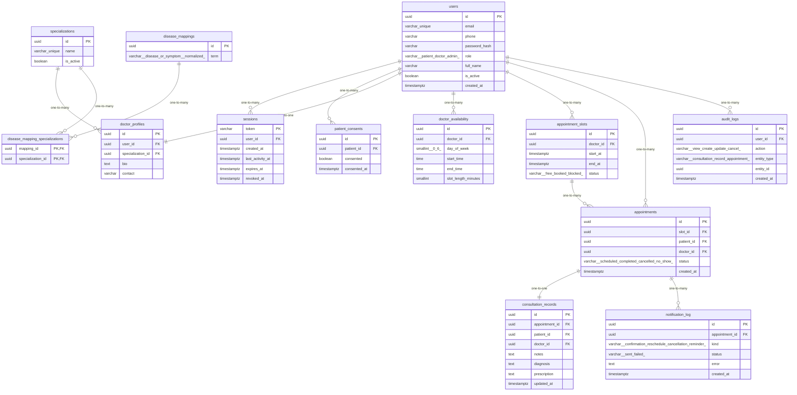

# Data Model

<!-- sdlc:auto:start entities -->
### users

| Field | Type | PK | FK | Nullable |
|---|---|---|---|---|
| id | uuid | True | — | False |
| email | varchar unique | False | — | False |
| phone | varchar | False | — | True |
| password_hash | varchar | False | — | False |
| role | varchar (patient\|doctor\|admin) | False | — | False |
| full_name | varchar | False | — | True |
| is_active | boolean | False | — | False |
| created_at | timestamptz | False | — | False |

### sessions

| Field | Type | PK | FK | Nullable |
|---|---|---|---|---|
| token | varchar | True | — | False |
| user_id | uuid | False | users.id | False |
| created_at | timestamptz | False | — | False |
| last_activity_at | timestamptz | False | — | False |
| expires_at | timestamptz | False | — | False |
| revoked_at | timestamptz | False | — | True |

### patient_consents

| Field | Type | PK | FK | Nullable |
|---|---|---|---|---|
| id | uuid | True | — | False |
| patient_id | uuid | False | users.id | False |
| consented | boolean | False | — | False |
| consented_at | timestamptz | False | — | False |

### specializations

| Field | Type | PK | FK | Nullable |
|---|---|---|---|---|
| id | uuid | True | — | False |
| name | varchar unique | False | — | False |
| is_active | boolean | False | — | False |

### doctor_profiles

| Field | Type | PK | FK | Nullable |
|---|---|---|---|---|
| id | uuid | True | — | False |
| user_id | uuid | False | users.id | False |
| specialization_id | uuid | False | specializations.id | False |
| bio | text | False | — | True |
| contact | varchar | False | — | True |

### disease_mappings

| Field | Type | PK | FK | Nullable |
|---|---|---|---|---|
| id | uuid | True | — | False |
| term | varchar (disease or symptom, normalized) | False | — | False |

### disease_mapping_specializations

| Field | Type | PK | FK | Nullable |
|---|---|---|---|---|
| mapping_id | uuid | True | disease_mappings.id | False |
| specialization_id | uuid | True | specializations.id | False |

### doctor_availability

| Field | Type | PK | FK | Nullable |
|---|---|---|---|---|
| id | uuid | True | — | False |
| doctor_id | uuid | False | users.id | False |
| day_of_week | smallint (0-6) | False | — | False |
| start_time | time | False | — | False |
| end_time | time | False | — | False |
| slot_length_minutes | smallint | False | — | False |

### appointment_slots

| Field | Type | PK | FK | Nullable |
|---|---|---|---|---|
| id | uuid | True | — | False |
| doctor_id | uuid | False | users.id | False |
| start_at | timestamptz | False | — | False |
| end_at | timestamptz | False | — | False |
| status | varchar (free\|booked\|blocked) | False | — | False |

### appointments

| Field | Type | PK | FK | Nullable |
|---|---|---|---|---|
| id | uuid | True | — | False |
| slot_id | uuid | False | appointment_slots.id | False |
| patient_id | uuid | False | users.id | False |
| doctor_id | uuid | False | users.id | False |
| status | varchar (scheduled\|completed\|cancelled\|no_show) | False | — | False |
| created_at | timestamptz | False | — | False |

### consultation_records

| Field | Type | PK | FK | Nullable |
|---|---|---|---|---|
| id | uuid | True | — | False |
| appointment_id | uuid | False | appointments.id | False |
| patient_id | uuid | False | users.id | False |
| doctor_id | uuid | False | users.id | False |
| notes | text | False | — | True |
| diagnosis | text | False | — | True |
| prescription | text | False | — | True |
| updated_at | timestamptz | False | — | False |

### notification_log

| Field | Type | PK | FK | Nullable |
|---|---|---|---|---|
| id | uuid | True | — | False |
| appointment_id | uuid | False | appointments.id | True |
| kind | varchar (confirmation\|reschedule\|cancellation\|reminder) | False | — | False |
| status | varchar (sent\|failed) | False | — | False |
| error | text | False | — | True |
| created_at | timestamptz | False | — | False |

### audit_logs

| Field | Type | PK | FK | Nullable |
|---|---|---|---|---|
| id | uuid | True | — | False |
| user_id | uuid | False | users.id | False |
| action | varchar (view\|create\|update\|cancel) | False | — | False |
| entity_type | varchar (consultation_record\|appointment) | False | — | False |
| entity_id | uuid | False | — | False |
| created_at | timestamptz | False | — | False |
<!-- sdlc:auto:end entities -->

<!-- sdlc:auto:start relationships -->
| Source | Target | Type |
|---|---|---|
| users | sessions | one-to-many |
| users | patient_consents | one-to-many |
| users | doctor_profiles | one-to-one |
| specializations | doctor_profiles | one-to-many |
| disease_mappings | disease_mapping_specializations | one-to-many |
| specializations | disease_mapping_specializations | one-to-many |
| users | doctor_availability | one-to-many |
| users | appointment_slots | one-to-many |
| appointment_slots | appointments | one-to-many |
| users | appointments | one-to-many |
| appointments | consultation_records | one-to-one |
| appointments | notification_log | one-to-many |
| users | audit_logs | one-to-many |
<!-- sdlc:auto:end relationships -->

<!-- sdlc:auto:start er-diagram -->

<!-- sdlc:auto:end er-diagram -->
