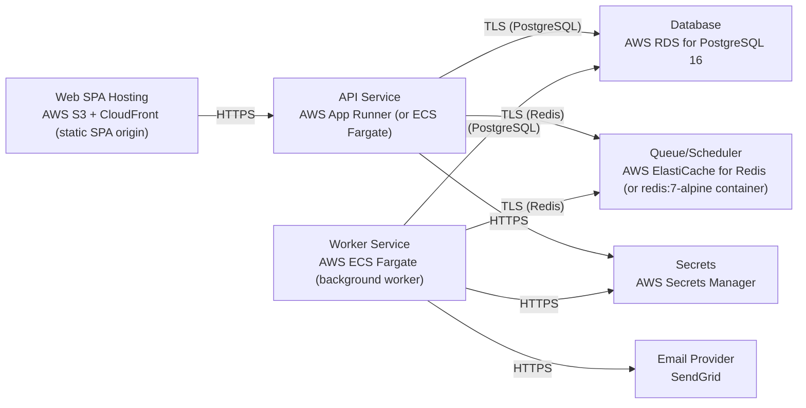

# Deployment Guide

> Maintained by QuorQ AI SDLC. Text between `sdlc:auto` markers is regenerated; anything outside them is yours and is kept.

<!-- sdlc:auto:start how-it-deploys -->
Pushes to `main` run `.github/workflows/deploy.yml`, which builds the API image (if there is a backend) and deploys the SPA to AWS Amplify. Commits touching only `docs/sdlc/**` don't deploy. Deployments can also be started from the platform's Deployment tab.
<!-- sdlc:auto:end how-it-deploys -->

<!-- sdlc:auto:start environments -->
| Name | Service | Runtime | Scaling | Environment |
|---|---|---|---|---|
| Web SPA Hosting | AWS S3 + CloudFront (static SPA origin) | React 19 static build | CDN-served static assets | dev |
| API Service | AWS App Runner (or ECS Fargate) | FastAPI 0.115 on Python / Uvicorn, HTTPS | 1 small instance for pilot, horizontal if needed | dev |
| Worker Service | AWS ECS Fargate (background worker) | Celery worker + beat on Python | 1 worker for pilot | dev |
| Database | AWS RDS for PostgreSQL 16 | PostgreSQL 16, encryption at rest (KMS), automated backups | single instance, pilot-sized | dev |
| Queue/Scheduler | AWS ElastiCache for Redis (or redis:7-alpine container) | Redis 7 | single node | dev |
| Email Provider | SendGrid | SaaS transactional email API | managed by provider | dev |
| Secrets | AWS Secrets Manager | stores SENDGRID_API_KEY, REDIS_URL, DATABASE_URL | managed | dev |
<!-- sdlc:auto:end environments -->

<!-- sdlc:auto:start live -->
**Frontend URL:** https://p881d1f68dbb1.dshared.amplifyapp.local

**Backend URL:** https://881d1f68dbb1.local.awsapprunner.local

**Database:** PostgreSQL · aisdlc_881d1f68dbb1

**Version:** 484160003c3e

**Commit:** `4841600`

**Finished:** 2026-11-16
<!-- sdlc:auto:end live -->

<!-- sdlc:auto:start topology -->

<!-- sdlc:auto:end topology -->
